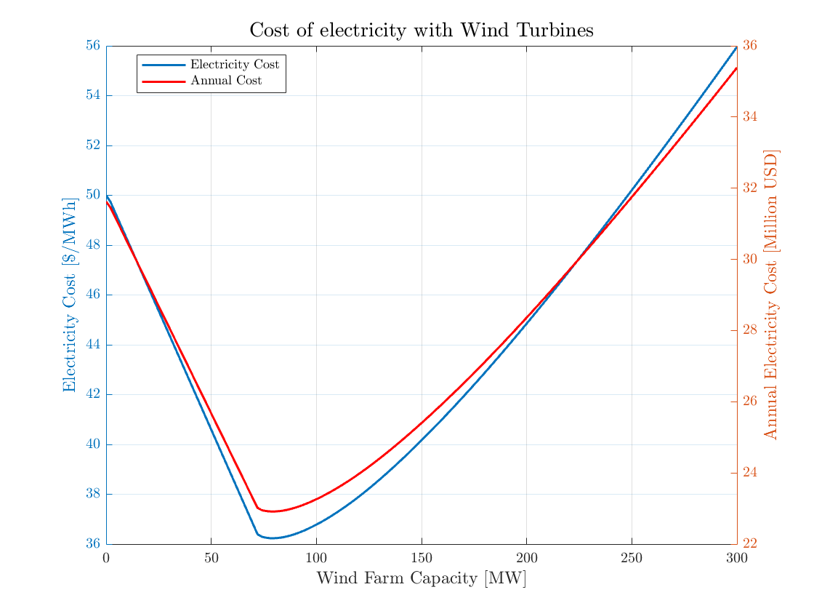
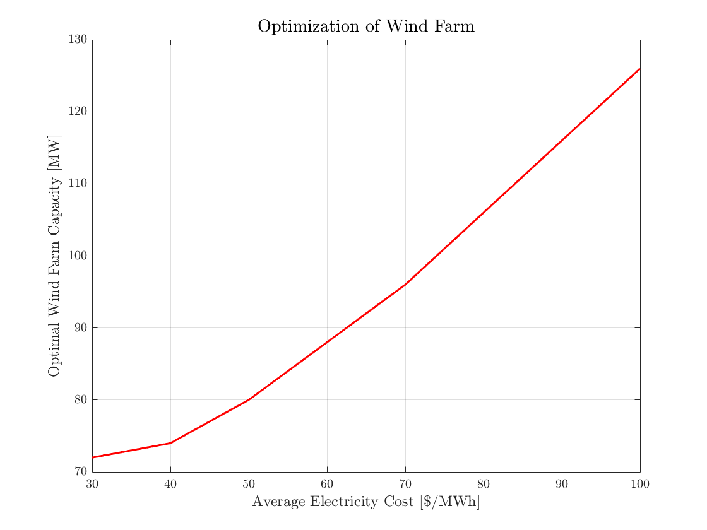
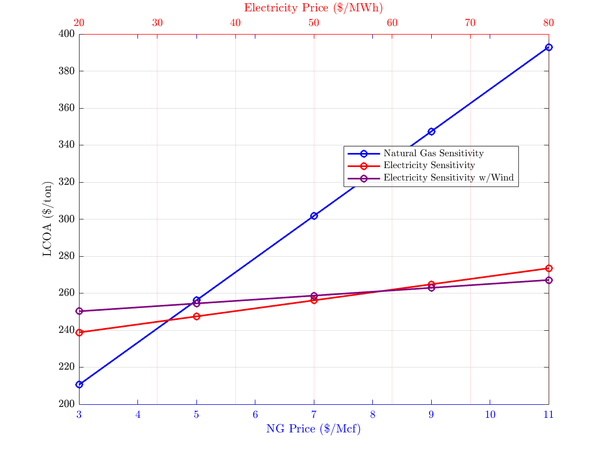
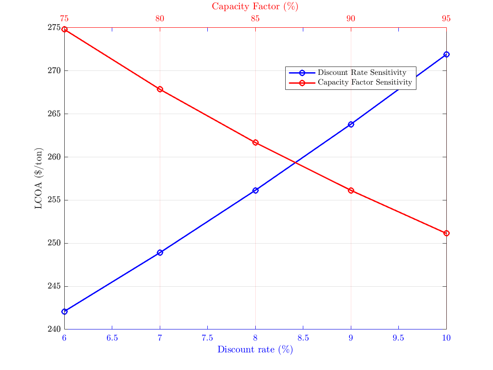
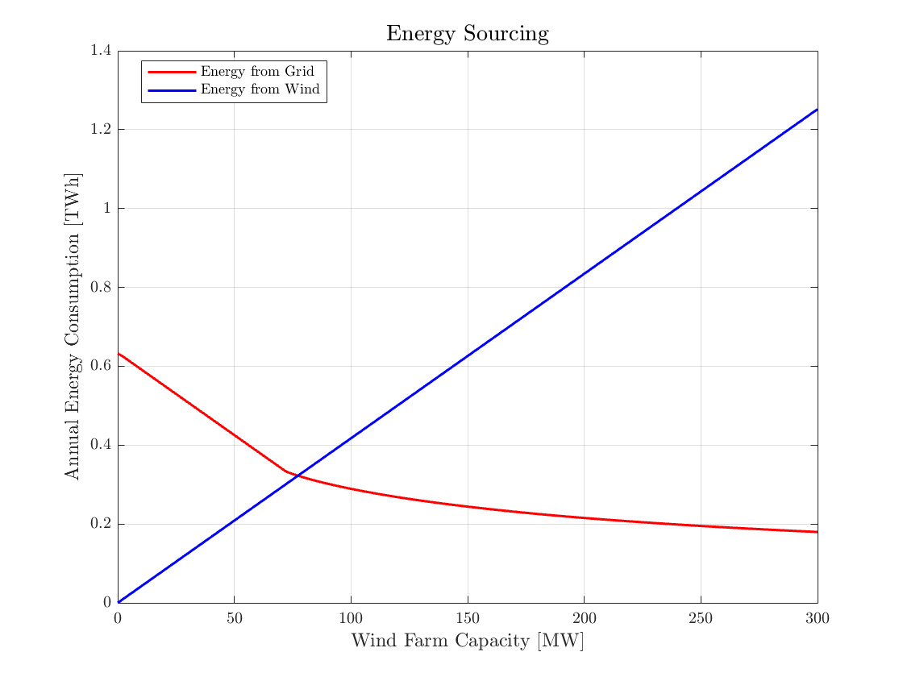
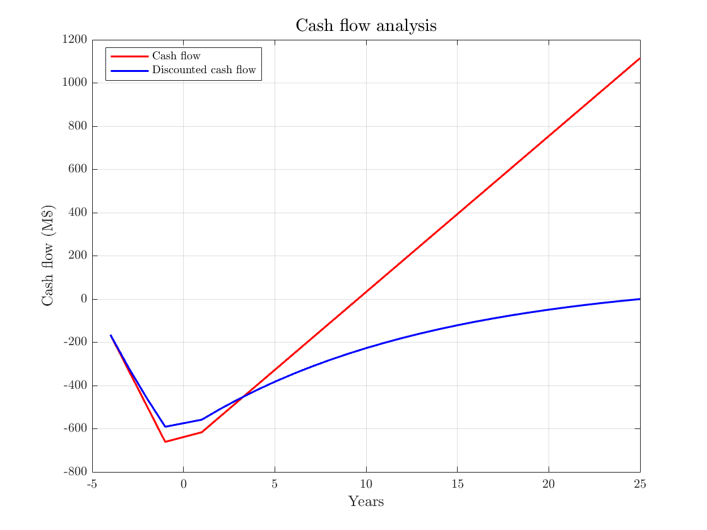

# Wind Supply Sizing and Techno-Economics for a Blue-Ammonia Plant

**How much wind should a 3,000 t/day blue-ammonia plant in Indiana build next to itself, and
what does its ammonia cost?** A year of 5-minute NREL wind data, a Vestas V110 power curve and
a 25-year cost model size the co-located wind farm against grid supply. Plant-level economics
come from a gas-switching-reforming (GSR) techno-economic model.

*ME 529 (Sustainable Energy), Purdue University, Fall 2024. Five-person project,
"Circular Economy for Ammonia Production in the State of Indiana". This repository holds my
part of it: the techno-economic analysis and renewable integration. The lifecycle assessment
was a separate team module and is not included.*



## Results

**Wind farm sizing** (72.2 MW continuous plant demand, $50/MWh grid electricity, 25-year life):

| | Value |
|---|---|
| V110 capacity factor at 100 m, West Lafayette, 2020 | **47.6%** |
| Levelized cost of wind electricity | ~$21/MWh |
| Cost-optimal wind farm | **80 MW** (40 turbines) |
| Plant average electricity cost at the optimum | **$36.2/MWh**, against $50/MWh grid-only (−28%) |

Below about 72 MW every wind MWh displaces grid power. Above it, a growing share of wind output
arrives when the plant is already covered, and it is curtailed because export is not credited.
That kink sets the optimum. The optimum grows with grid price, from 72 MW at $30/MWh to
126 MW at $100/MWh:



**Plant economics** (GSR plant with inherent CO₂ capture, 8% discount rate):

| Scenario | Levelized cost of ammonia | Market price at 21% margin |
|---|---|---|
| Grid electricity | **$256.1/t** | $309.9/t |
| With 80 MW wind | $258.7/t | $313.0/t |
| With hydrogen cogeneration | $270.4/t | $327.2/t |

- Capital investment is **$660.8M**, with a 10-year simple payback.
- All three scenarios undercut the reference blue-ammonia market prices used in the study
  ($403/t Middle East, $516/t US Gulf Coast).
- **Natural gas price dominates**: LCOA runs from about $210 to $390/t across $3–11/Mcf.
  Electricity price, discount rate and capacity factor each move it far less.

| Sensitivity to energy prices | Sensitivity to discount rate and capacity factor |
|---|---|
|  |  |

| Grid and wind energy by farm size | Plant cash flow (grid case) |
|---|---|
|  |  |

## Repository layout

```
src/
  windFarmSizing.m     wind farm sizing and electricity-cost optimization (main script)
  simulateWind.m       one V110 2 MW turbine, 5-minute output for 2020
  importWind.m         NREL WRDB CSV import and resampling
  plotSensitivity.m    LCOA sensitivity and cash-flow plots from results/
  dataDir.m
data/
  west-lafayette-2020-wind.csv    NREL Wind Resource Database, 80/100/120 m, 5-minute
results/
  sensitivity_results.csv         LCOA vs NG price, electricity price, DR, CF (grid case)
  sensitivity_resultsw.csv        same, with wind
  cashflow_results.csv            annual and discounted cash flow, M$
figures/
```

## Running it

MATLAB R2020b or later, no toolboxes. From the repository root:

```matlab
run src/windFarmSizing.m    % sizing curves and price sweep
run src/plotSensitivity.m   % LCOA sensitivity and cash flow
```

## How the LCOA was obtained

Plant-level costs (LCOA, CAPEX, cash flow and the sensitivity tables in `results/`) come from the
published GSR techno-economic model, the SEA tool by Arnaiz del Pozo and Cloete (2021). I
updated it with Indiana natural gas and electricity prices and the wind and cogeneration costs
from this analysis. The tool itself is theirs and is not redistributed. The tables in
`results/` are the outputs I generated with it.

## Limitations

- One weather year (2020) and a single turbine model; no wake losses or availability derating.
- Plant demand is constant. No storage, and no credit for exported surplus.
- Grid price is a single flat average; time-of-use pricing would change the optimum.

## References

- C. Arnaiz del Pozo, S. Cloete. *SEA tool files: Blue-Green Ammonia*, 2021.
- NREL Wind Resource Database, [wrdb.nrel.gov](https://wrdb.nrel.gov/data-viewer).
- Vestas Wind Systems, *Vestas 2 MW Platform*.

## Author

**Jose Ernesto Sandoval Hernandez**, MSc Mechanical Engineering, Purdue University.
Teammates on the full project: Pranav Ravi, Matias Alvarado, Karthickeyan Marimuthu, Dhedan Aldossary.

[LinkedIn](https://www.linkedin.com/in/jsahe) · [Google Scholar](https://scholar.google.com/citations?user=cL2oeXIAAAAJ&hl=en)
